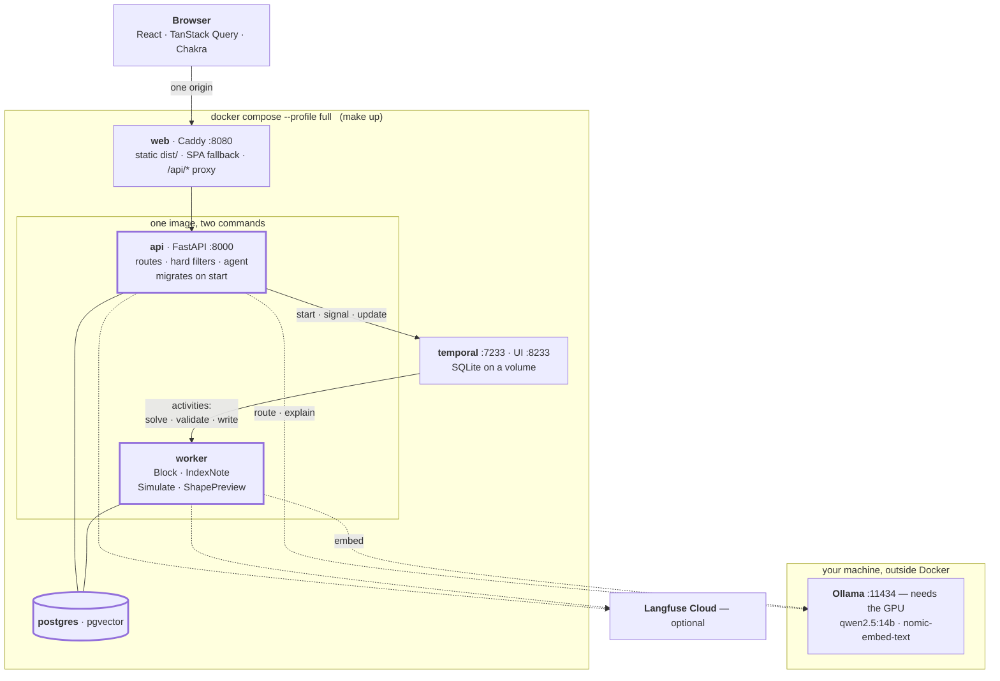

# Powerlifting Block Planner

An agent that plans an 11-week strength block from the athlete's current 1RMs, pins each session to fixed weekdays, reschedules around missed sessions, and rolls into the next block when a new max is tested.

The spreadsheet this replaces knows "Day 1, Day 2, Day 3" — not Monday/Wednesday/Friday, not dates, and it has no answer for a missed session. The planner assigns dates, proposes repairs when a session is missed, and refuses plans that break the rules. **A solver proposes, a validator rejects, and a human approves; the LLM routes and explains but never computes a number.**


Solo portfolio project: one athlete, no authentication, local-first. Everything runs on your own machine — the model included — and no paid service is required to build or use it. Domain background is in [CONTEXT.md](CONTEXT.md); the implementation specs are in [.claude/specs/](.claude/specs/), built in the order given by [00-Spec_Index.md](.claude/specs/00-Spec_Index.md).

---

## Architecture



Also at [docs/architecture.png](docs/architecture.png); the source is [docs/architecture.mmd](docs/architecture.mmd). The thick-bordered boxes are the ones allowed to produce a number.

### Factory → gym

This is a production-planning agent whose domain happens to be a gym. The mapping is exact enough that the same engine runs a job-shop adapter:

| Production planning | This project |
| --- | --- |
| Job | Planned session |
| Operation | A lift's set block within a session |
| Machine | Weekday slot |
| Machine calendar | The athlete's fixed weekday map |
| Setup / changeover time | Minimum rest gap between sessions sharing a lift |
| Precedence constraint | Week order; a lift's test must follow its ramp |
| Breakdown | Missed session |
| Makespan | Block finish date |
| Capacity | Recoverable weekly volume |

That is why the engine is split in two: `planner_core/` is domain-agnostic (config, database, proposals, LLM, tracing) and `domains/strength/` is the powerlifting plug-in. `planner_core/` must not import from `domains/`, and the domains must not import each other.

---

## Quick start

**Prerequisites**

| Need | Why | Install |
| --- | --- | --- |
| Docker Desktop (Compose v2) | the whole stack | `winget install -e --id Docker.DockerDesktop` |
| [Ollama](https://ollama.com) on the **host** | the agent needs the GPU, so it is never in Compose | `winget install -e --id Ollama.Ollama` |
| GNU Make | the targets below | `winget install -e --id ezwinports.make` |

```bash
ollama pull qwen2.5:14b        # the agent and the router, ~9 GB
ollama pull nomic-embed-text   # embeddings, 768 dimensions

cp .env.example .env           # every default is already local-safe
make up                        # builds the images, then starts five services
```

> **On a 16 GB machine, use `qwen2.5:7b` instead.** `make up` plus a 9 GB model does not fit: measured on a 16 GB box with a 6 GB GPU, the stack left 1.6 GB of RAM free and a single generation did not return in ten minutes. `qwen2.5:7b` (4.7 GB) loads in ~100 s at 84% GPU and answers a reschedule turn in about three minutes. Set `OLLAMA_CHAT_MODEL` and `OLLAMA_ROUTER_MODEL` to it in `.env`. The router accuracy below was measured on the 14b, so a smaller model is a trade, not a free win.

| | |
| --- | --- |
| App | <http://localhost:8080> |
| API docs | <http://localhost:8080/api/docs> |
| Temporal UI | <http://localhost:8233> |

The first `make up` builds two images and takes a few minutes; after that it is seconds. `make logs` follows the api and worker, `make ps` shows what is running, and `make down` stops everything **without** losing data.

Then put some data in it:

```bash
make demo-data DOCKER=1        # athlete + template + ~40 synthetic notes
```

`DOCKER=1` runs the target inside the api container; without it the same target runs on the host against `localhost`. `make demo-data` needs `data/B1_Mine.xlsx` — the authored template is the athlete's own file and is not committed, so use yours. Compose mounts `./data` into the container read-only.

**Then open the app and enter your 1RMs.** The wizard asks for each lift's max and the date you tested it, maps Day 1/2/3 onto real weekdays, and plans the block for you to approve.

That last step is not an oversight that could be automated away. **A 1RM is a measurement, and nothing in this project may invent one** — not an importer, not a seed, not a migration. `make demo-data` deliberately stops short of it. The workbook's own `1RM` sheet is never read, because those maxes are examples.

If you only want to see the thing move, there is a labelled shortcut:

```bash
make seed-dev-1rms DOCKER=1    # SYNTHETIC maxes, for local testing only
```

Every row it writes is marked twice — `is_synthetic = true` and `source = 'synthetic'`, with a database `CHECK` stopping the two from disagreeing — and the app shows a banner on every screen while any such row exists. `make seed-dev-1rms ARGS=--clear` removes them and leaves real rows alone.

### Demo


"I can't train on 2 November" → the agent proposes a move, with its cost and its warnings → approve → the session shifts to Tuesday and is marked `moved` → the decision trace shows which route fired, which three tools ran and for how long, and that the solver returned `OPTIMAL`.

Recorded against the containerised stack with `qwen2.5:7b`. Every weight in it comes from synthetic 1RMs, which is what the banner along the top is there to say.

---

## How a decision is made

Every chat turn runs the same pipeline, and [the decisions screen](http://localhost:8080/decisions) shows each step of it afterwards:

1. **Hard filters, in deterministic Python, before any model call.** Pain and injury keywords, a missing 1RM, a missing weekday map. A message that mentions pain takes the safety route and never reaches the LLM at all — a safety rule whose answer depends on a similarity threshold is a safety rule that can be argued with.
2. **The router picks one of four actions** from the already-safe routes left over. It chooses; it does not compute.
3. **Tools run**: the generator, the calendar solver, the missed-session policy, the shaping solver, the simulator, notes retrieval. These produce every number.
4. **The validator rules on the result.** Violations reject a plan; Prilepin ranges and the volume trend are warnings, because a rule that rejects the author's own training plan is miscalibrated, not strict.
5. **A proposal is written, and nothing is applied until a human approves it.** `approve_proposal` is the one write path.
6. **The explainer writes prose** and post-checks that every number in its output appears in the object it was given.

The simulator answers with percentiles and an assumptions list, never a single predicted number. Where a threshold is a guess — the missed-session tiers, the Banister constants — it is labelled as a starting value in both the code and the UI rather than presented as derived.

---

## Router accuracy

How often the router picks the right one of four actions, on 30 labelled messages (`make eval-router`):

| Provider | Model | Correct | Unusable output |
| --- | --- | --- | --- |
| `ollama` (default) | qwen2.5:14b | **29 / 30 — 97%** | 0 |
| `anthropic` | claude-haiku-5-5 | not run | — |

The target was ≥ 90%, so the local model cleared the bar and the paid comparison was never needed. To run it yourself — it costs money, which is why it needs the flag:

```bash
LLM_PROVIDER=anthropic make eval-router ARGS=--yes
```

Separately, `make check-llm` asks five questions that cannot be answered without calling a tool, and reports how many actually did. **Target is 5/5.** The design gives the model no authority to compute anything, so unreliable tool calling does not degrade the output — it invents weights. Below 5/5, move up to `qwen2.5:32b` before going further.

### Switching to Claude for a demo

```bash
# in .env
LLM_PROVIDER=anthropic
ANTHROPIC_API_KEY=sk-ant-...
```

Then `make up` again. This changes the agent and nothing else: no other module imports a provider SDK, so the router, the tools and the tests are identical either way. `LLM_PROVIDER=anthropic` without a key fails at startup, by design.

**Embeddings ignore that switch and always run on Ollama.** That is not an omission: the vectors in `note_chunk` are only comparable to each other, so letting a demo flag change the embedding model would silently invalidate every note already indexed.

---

## Developing on the host

The containers are for running the project. For hot reload, run the infrastructure in Docker and the rest on the host:

```bash
make infra     # postgres + temporal only
make migrate && make seed && make import
make api       # uvicorn --reload on :8000
make worker    # the other half: nothing advances a block without it
make web       # Vite on :5173
```

This needs Python 3.12 with [uv](https://docs.astral.sh/uv/) and Node ≥ 24.15 as well as Docker.

> **Do not run `make worker` on the host while `make up` is running.** Both modes share one database and one Temporal server, so two workers would poll the same task queue and both claim the same block's activities.

### Make targets

Each is a thin wrapper; the raw command is given so the Makefile is never the only way in.

`DOCKER=1` runs a target inside the api container instead of on the host. It applies to `migrate`, `migrate-sql`, `seed`, `seed-dev-1rms`, `demo-notes`, `import` and `demo-data`, and to nothing else — `eval-router` reads `tests/`, which the image excludes, and `calibrate` would write its `gains.json` into a layer the next `make up` discards. It follows `COMPOSE_PROJECT_NAME`, so a second stack is addressed with `COMPOSE_PROJECT_NAME=scratch make demo-data DOCKER=1` and not with `-p`, which make never sees.

| Target | Runs |
| --- | --- |
| `make up` | `docker compose --profile full up -d --build` |
| `make down` | `docker compose --profile full down` — keeps the volumes |
| `make logs` / `make ps` | follow api + worker; list the stack |
| `make infra` | `docker compose up -d postgres temporal` |
| `make infra-down` | stop them, keeping workflow history |
| `make infra-reset` | `docker compose down -v` — **deletes the block and its workflows** |
| `make api` / `make worker` / `make web` | the three host processes |
| `make migrate` / `make migrate-sql` | `alembic upgrade head`, with or without executing |
| `make seed` | the athlete; no 1RMs, by design |
| `make import` | `data/B1_Mine.xlsx` → template B1, 77 entries (`ARGS=--replace`) |
| `make seed-dev-1rms` | **synthetic** 1RMs (`ARGS=--clear` removes them) |
| `make demo-notes` | **synthetic** training notes (needs Ollama) |
| `make demo-data` | `seed` + `import` + `demo-notes` |
| `make calibrate` | simulator gains from the OpenPowerlifting CSV |
| `make check-llm` / `make eval-router` | measure the model before trusting it |
| `make test` / `make lint` / `make format` | pytest; ruff check + format |
| `make test-web` / `make gen-api` | vitest; regenerate the API types from a running API |

`make migrate` and `make seed` are idempotent. `make import` refuses a name that already exists.

---

## Configuration

Everything is read through `get_settings()` in [backend/planner_core/config.py](backend/planner_core/config.py); nothing else touches `os.environ`. [.env.example](.env.example) lists every variable with its default, and **no secret is ever baked into an image** — Compose passes `.env` at run time.

`make up` passes this file to the containers and overrides four values, because `localhost` inside a container is the container:

| Variable | Default | Container (`make up`) |
| --- | --- | --- |
| `DATABASE_URL` | `…@localhost:5432/planner` | `…@postgres:5432/planner` |
| `TEMPORAL_ADDRESS` | `localhost:7233` | `temporal:7233` |
| `OLLAMA_BASE_URL` | `http://localhost:11434` | `http://host.docker.internal:11434` |
| `CORS_ORIGINS` | `["http://localhost:5173"]` | `[]` — one origin, so nothing is cross-origin |

> **The host targets do not read the root `.env`.** Settings load `.env` relative to the working directory and `make api` / `make worker` `cd backend` first, so they use the defaults in `config.py` unless you export a variable yourself. That is deliberate rather than tidy: it means tracing — which sends prompts and note text to Langfuse — cannot switch itself on for host development just because a key sits in a file at the repo root.

Two more that cost time otherwise:

- `CORS_ORIGINS` is a list, so it must be JSON: `CORS_ORIGINS=["http://localhost:5173"]`.
- `WEB_PORT`, `POSTGRES_PORT`, `TEMPORAL_PORT` and `TEMPORAL_UI_PORT` move the published ports, for running a second stack beside the first:

  ```bash
  COMPOSE_PROJECT_NAME=scratch WEB_PORT=8081 TEMPORAL_UI_PORT=18233 make up
  ```

  Use `COMPOSE_PROJECT_NAME` rather than `-p`: it gives the second stack its own volumes *and* is the one form the Make targets inherit. The api's own 8000 is deliberately never published — Caddy is the way in.

### Tracing (optional)

With `LANGFUSE_PUBLIC_KEY` and `LANGFUSE_SECRET_KEY` set, each decision is traced to [Langfuse](https://langfuse.com) Cloud's free tier and the decisions screen links to it. Add `LANGFUSE_PROJECT_ID` as well, or the link cannot be built. Leave the keys blank and the app runs identically, logging `Tracing disabled (no Langfuse keys)`.

Traces include prompts and the note text that went into them, which is the point of having them — so this is the one feature that sends your data anywhere, and it is off until you turn it on.

### Changing the embedding model

`OLLAMA_EMBED_MODEL` cannot be changed on its own. Three things move together:

1. Set `EMBED_DIM` to the new model's width. `OllamaEmbedder` refuses a vector of any other size rather than letting it reach the database.
2. Migrate `note_chunk.embedding`, which is `VECTOR(768)` — a different width is a schema change, not a setting.
3. Re-embed everything with `POST /athletes/{id}/notes/reindex`. Vectors from two models are not comparable, so a half-migrated table returns confident nonsense rather than an error.

---

## Data it keeps, and where it came from

| | |
| --- | --- |
| `data/B1_Mine.xlsx` | The athlete's own training template. **Not committed.** Only its *pattern* is imported — which lift trains on which day of which week, for how many sets and reps, at what intensity — stored as the exact authored fraction (`70/120`), never as a computed weight. Its two known spreadsheet errors are worked around in code and documented in [CONTEXT.md](CONTEXT.md) §4. |
| 1RMs | Yours, entered in the app with the date you tested them. The only maxes the planner computes from. |
| Demo notes | **Synthetic**, flagged `is_synthetic`. Search hides them unless you pass `include_synthetic=true`, and pain screening ignores them entirely — a seeded note about a sore knee must never be able to block a real session. |
| Development 1RMs | **Synthetic**, from `make seed-dev-1rms` only, and surfaced in the UI while any exist. |
| [OpenPowerlifting](https://openpowerlifting.org/data) bulk export | Public domain. Optional, ~1 GB, never committed. `make calibrate` reduces it to a small `gains.json`; until that exists the simulator falls back to a flat 2–5% gain range and says so in its assumptions. |

Prilepin's table and the Brzycki rep-max relation are standard published training heuristics. Neither is copied verbatim: the rep-max percentages are the author's own workbook column, and Prilepin's zones are hard-coded because the workbook's copy was coerced into dates by Excel and is unrecoverable.

### Schema

Fourteen tables, created only by Alembic — there is no `create_all()` anywhere in application code. `make migrate-sql` prints the DDL without touching a database if you want to read it first. Three things about it are deliberate and easy to "fix" by mistake:

- **Percentages are a numerator/denominator pair of `NUMERIC(10,4)`**, not a rounded float and not integers. The authored template contains `112.5/105` and `72.5/70`, so integers cannot express it. Exactness is preserved by `Fraction(Decimal(num)) / Fraction(Decimal(den))` — note the single-argument constructor; `Fraction(Decimal, Decimal)` raises `TypeError`. A golden test reproduces all 77 weights from the spreadsheet and is not to be weakened to accommodate a refactor.
- **Every enum-like column has a database `CHECK`.** SQLModel `table=True` classes bypass Pydantic validation entirely, so the `CHECK` is what rejects a bad status.
- **`weekday` is `0 = Monday`**, matching Python's `date.weekday()`. PostgreSQL's `EXTRACT(DOW)` is `0 = Sunday` and `ISODOW` is `1 = Monday`, so comparing the column against either in raw SQL without converting is off by a day.

---

## Troubleshooting

**`/api/health` says `"ollama": "down"`.** The containers reach Ollama on the host at `host.docker.internal`, which Compose maps with `host-gateway`. If it is unreachable, Ollama is probably bound to `127.0.0.1` only: set `OLLAMA_HOST=0.0.0.0` in its environment and restart it. On Linux, check that your Docker version honours `extra_hosts: ["host.docker.internal:host-gateway"]`.

`/health` always answers 200 and reports each dependency separately, so "the API is up but Postgres is gone" is distinguishable from "the API is gone":

```json
{"status": "ok", "db": "ok", "temporal": "ok", "ollama": "ok"}
```

**The api keeps restarting.** It runs `alembic upgrade head` before uvicorn, so a failed migration exits the container; `make logs` shows the Alembic error above each restart.

**A port is already in use.** Set `WEB_PORT`, `POSTGRES_PORT`, `TEMPORAL_PORT` or `TEMPORAL_UI_PORT` in `.env`.

**Turning off Wi-Fi.** Everything keeps working except tracing: the model, the database, the workflow engine and the solvers are all local.

---

## Putting it on the internet

Local-first is the design, and a public URL is an optional extra. **There is no login in this app**, so before any public link, uncomment the `basic_auth` block in [frontend/Caddyfile](frontend/Caddyfile) and paste in a hash:

```bash
docker compose run --rm --entrypoint caddy web hash-password
```

| Option | Cost | When |
| --- | --- | --- |
| **Cloudflare Tunnel** — `cloudflared tunnel --url http://localhost:8080` | free | A live walkthrough. Reachable only while your machine and the tunnel are running |
| **Small VPS** | ~€5/month, or free on Oracle's ARM tier | An always-on link. Check the GitHub Student Developer Pack for hosting credits first |

A VPS has no GPU, so run it with `LLM_PROVIDER=anthropic` and a spending cap, or a small CPU model. Embeddings still need Ollama, but `nomic-embed-text` runs fine on CPU.

---

## Layout

```
backend/
  planner_core/      domain-agnostic engine — config, db, proposal, llm, tracing
  domains/strength/  powerlifting plug-in — importer, generator, validator,
                     solvers, simulator, notes, agent/, workflows/
  migrations/        Alembic; the only way the schema ever changes
  api/               FastAPI app, routes/, deps
  scripts/           import, golden fixture, seeds, router eval
  tests/
frontend/            React + TS + Vite + TanStack Query + Chakra
data/B1_Mine.xlsx    the authored template everything derives from — not committed
.claude/specs/       numbered implementation specs, in build order
docs/adr/            architecture decision records
```
