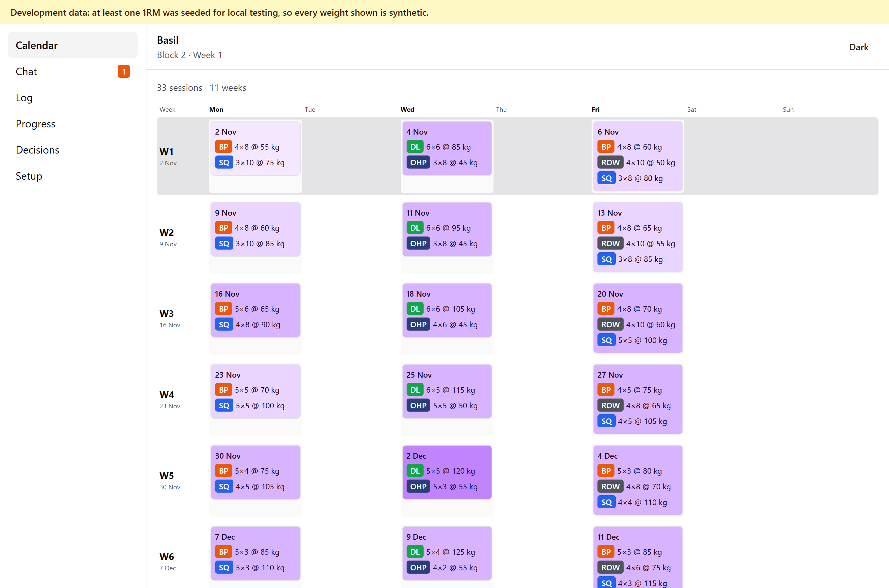
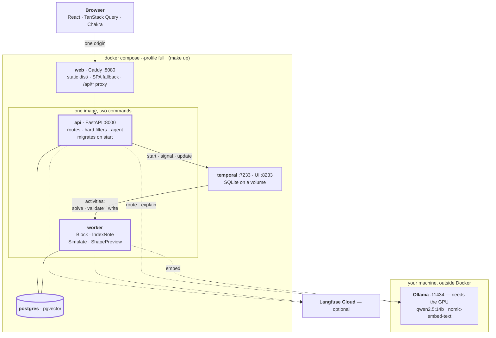
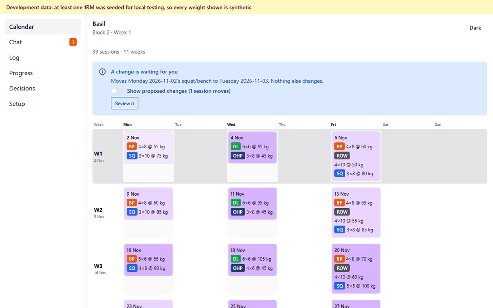

# Powerlifting Block Planner

An agent that plans an 11-week strength block from the athlete's current 1RMs, pins each session to fixed weekdays, reschedules around missed sessions, and rolls into the next block when a new max is tested.

A training program on paper says "Day 1, Day 2, Day 3" — not Monday/Wednesday/Friday, not dates, and it has no answer for a missed session. The planner assigns dates, proposes repairs when a session is missed, and refuses plans that break the rules. 



Solo portfolio project: one athlete, no authentication, local-first. Everything runs on your own machine — the model included — and no paid service is required to build or use it. The training vocabulary, the template and the rules the planner enforces are described under [The training block](#the-training-block).

---

## Architecture



Also at [docs/architecture.png](docs/architecture.png); the source is [docs/architecture.mmd](docs/architecture.mmd). The thick-bordered boxes are the ones allowed to produce a number.

---

## Quick start

**Prerequisites**

| Need | Why | Install |
| --- | --- | --- |
| Docker Desktop (Compose v2) | the whole stack | `winget install -e --id Docker.DockerDesktop` |
| [Ollama](https://ollama.com) on the **host** | the agent needs the GPU, so it is never in Compose | `winget install -e --id Ollama.Ollama` |
| GNU Make | the targets below | `winget install -e --id ezwinports.make` |

```bash
ollama pull qwen2.5:14b        # the agent and the router, ~9 GB
ollama pull nomic-embed-text   # embeddings, 768 dimensions

cp .env.example .env           # every default is already local-safe
make up                        # builds the images, then starts five services
```

| | |
| --- | --- |
| App | <http://localhost:8080> |
| API docs | <http://localhost:8080/api/docs> |
| Temporal UI | <http://localhost:8233> |

The first `make up` builds two images and takes a few minutes; after that it is seconds. `make logs` follows the api and worker, `make ps` shows what is running, and `make down` stops everything **without** losing data.

**Then open the app and enter your 1RMs.** The 11-week program ships with the app and is loaded on the first start, so there is nothing to import. The wizard asks for each lift's max and the date you tested it, maps Day 1/2/3 onto real weekdays, and plans the block for you to approve. Everyone gets the same program; every weight is computed from their own maxes.

That last step is not an oversight that could be automated away. **A 1RM is a measurement, and nothing in this project may invent one** — not a seed, not a migration, not a default.

Optionally, give the notes search something to find:

```bash
make demo-data DOCKER=1        # the athlete + ~40 SYNTHETIC training notes (needs Ollama)
```

`DOCKER=1` runs the target inside the api container; without it the same target runs on the host against `localhost`. It creates the athlete first, which `make seed-dev-1rms` below also needs. Demo notes are flagged `is_synthetic`: search hides them unless you pass `include_synthetic=true`, and pain screening ignores them entirely, so a seeded note about a sore knee can never block a real session.

If you only want to see the thing move, there is a labelled shortcut:

```bash
make seed-dev-1rms DOCKER=1    # SYNTHETIC maxes, for local testing only
```

Every row it writes is marked twice — `is_synthetic = true` and `source = 'synthetic'`, with a database `CHECK` stopping the two from disagreeing — and the app shows a banner on every screen while any such row exists. `make seed-dev-1rms ARGS=--clear` removes them and leaves real rows alone.

### Demo



"I can't train on 2 November" → the agent proposes a move, with its cost and its warnings → approve → the session shifts to Tuesday and is marked `moved` → the decision trace shows which route fired, which three tools ran and for how long, and that the solver returned `OPTIMAL`.

Recorded against the containerised stack with `qwen2.5:7b`. Every weight in it comes from synthetic 1RMs, which is what the banner along the top is there to say.

---

## How a decision is made

Every chat turn runs the same pipeline, and [the decisions screen](http://localhost:8080/decisions) shows each step of it afterwards:

1. **Hard filters, in deterministic Python, before any model call.** Pain and injury keywords, a missing 1RM, a missing weekday map. A message that mentions pain takes the safety route and never reaches the LLM at all — a safety rule whose answer depends on a similarity threshold is a safety rule that can be argued with.
2. **The router picks one of four actions** from the already-safe routes left over. It chooses; it does not compute.
3. **Tools run**: the generator, the calendar solver, the missed-session policy, the shaping solver, the simulator, notes retrieval. These produce every number.
4. **The validator rules on the result.** Violations reject a plan; Prilepin ranges and the volume trend are warnings, because a rule that rejects the author's own training plan is miscalibrated, not strict.
5. **A proposal is written, and nothing is applied until a human approves it.** `approve_proposal` is the one write path.
6. **The explainer writes prose** and post-checks that every number in its output appears in the object it was given.

The simulator answers with percentiles and an assumptions list, never a single predicted number. `make calibrate` fits its progression gains from the public-domain [OpenPowerlifting](https://openpowerlifting.org/data) export (~1 GB, never committed); until that has been run it falls back to a flat 2–5% gain range and says so in its assumptions. Where a threshold is a guess — the missed-session tiers, the Banister constants — it is labelled as a starting value in both the code and the UI rather than presented as derived.

---

## The training block

### Vocabulary

- **1RM** — one-rep max, the heaviest single for a lift. Stored per athlete per block, always with the date it was tested.
- **Block** — one 11-week cycle: 11 weeks × 3 slots = 33 sessions.
- **Slot** — the template's Day 1 / Day 2 / Day 3, mapped once to real weekdays by the athlete and then fixed.
- **Session** — one slot on one date, carrying one or more lifts' set blocks.
- **Entry** — one row of the template: lift × week × slot, with sets, reps and intensity.
- **Intensity** — a share of 1RM, stored as an exact fraction such as `70/120`.
- **Working weight** — `1RM × intensity`, snapped to a multiple of the athlete's plate increment. A new athlete defaults to **5 kg, nearest**, because plates load in pairs and the smallest is 2.5 kg.
- **Rep-max percentage** — the share of 1RM a trained lifter can hold for *n* reps (Brzycki-style).
- **Relative intensity** — intensity ÷ rep-max percentage. 1.0 is at the limit for that rep count; above 1.0 is overreaching, which the template only permits from week 7.
- **Test** — a single above 100%, which becomes the new max. One per lift, except row.
- **Proposal** — a candidate change (new block, reschedule, weekday change) with its validation result, waiting for approval.
- **Decision** — one chat turn's trace: which filter fired, which route was chosen, which tools ran with what inputs and outputs.

### The template

Intensity starts near 50% and finishes above 100%: the final single *is* the new max test. When a block ends, the tested maxes become the new 1RMs and the same template generates the next block at the new weights.

| Lift | Entries | Slot(s) | Test |
| --- | --- | --- | --- |
| Deadlift | 11 | 2 | W11 S2, 1×1 @ 170/160 |
| Squat | 22 | 1 and 3 | W11 S1, 1×1 @ 130/120 |
| Bench | 22 | 1 close grip, 3 wide grip (W10 both wide) | W10 S3, 1×1 @ 112.5/105 |
| Press | 11 | 2 | W9 S2, 1×1 @ 72.5/70 |
| Row | 11 | 3 | none — row is never tested |

**77 entries, 4 tests.** The program lives in [backend/domains/strength/templates/b1.json](backend/domains/strength/templates/b1.json) as a pattern only — lift, week, slot, sets, reps and the intensity fraction — with no weights and no maxes in it. The intensity denominator is *not* a 1RM: it is the target max the block was programmed against, an authored value in its own right. A weight is always the athlete's own 1RM × `num/den`, snapped to the increment.

A golden test reproduces 77 reference weights from those fractions exactly, and another pins the shipped file to that reference entry for entry, so the program cannot drift. Prilepin's zones and the Brzycki rep-max percentages are standard published heuristics, hard-coded in the validator.

### What the validator enforces

Hard rules reject a plan; soft rules attach a warning and let it through. The split is calibrated so the author's own block passes with zero violations.

**Hard:** a session off its home weekday without approval; two sessions on one date; dates not increasing; two sessions sharing a lift closer than the rest gap; above 100% earlier than the week before that lift's test; above 110% anywhere; relative intensity above 1.0 before week 7 or above 1.10 anywhere; a weight that is not a multiple of the plate increment; progression on a lift with a pain note in the last 7 days; a date in the past.

**Soft:** Prilepin reps-per-set and total reps outside the zone; weekly volume rising while weekly top intensity also rises.


### Missed sessions

Four tiers, by how long the athlete was away. The thresholds are **starting values**, not derived ones, and the UI says so:

| Tier | Gap | Response |
| --- | --- | --- |
| Short | ≤ 2 days | Move the session to the next free day that keeps the rest gap |
| Week | ≤ 10 days | Repeat the week, or step back one week |
| Illness | ≤ 21 days | Step back and re-ramp; reduce the top set |
| Restart | longer | Restart the block, optionally re-testing first |

The solver returns one to three options with their costs and the athlete picks one. A session counts as missed 12 hours after the end of its day, so a late-evening session still counts; a rejected reschedule is left alone for 24 hours so the athlete is not asked the same question in a loop. Both are starting values too.

### Known limits

- **Local-model tool calling is the biggest risk**, which is why `make eval-router` and `make check-llm` exist.
- **One athlete, by design.** Multi-user would be a rewrite, not a feature.
- **No authentication.** Fine locally; see [Putting it on the internet](#putting-it-on-the-internet) before exposing it.
- **Chat history is truncated to the last 10 messages**, with no summarisation.
- **Press and row have no meet data**, so the simulator borrows a scaled bench distribution and says so in its assumptions.

---

## Router accuracy

How often the router picks the right one of four actions, on 30 labelled messages (`make eval-router`):

| Provider | Model | Correct | Unusable output |
| --- | --- | --- | --- |
| `ollama` (default) | qwen2.5:14b | **29 / 30 — 97%** | 0 |
| `anthropic` | claude-haiku-5-5 | not run | — |

The target was ≥ 90%, so the local model cleared the bar and the paid comparison was never needed. To run it yourself — it costs money, which is why it needs the flag:

```bash
LLM_PROVIDER=anthropic make eval-router ARGS=--yes
```

Separately, `make check-llm` asks five questions that cannot be answered without calling a tool, and reports how many actually did. **Target is 5/5.** The design gives the model no authority to compute anything, so unreliable tool calling does not degrade the output — it invents weights. Below 5/5, move up to `qwen2.5:32b` before going further.

### Switching to Claude for a demo

```bash
# in .env
LLM_PROVIDER=anthropic
ANTHROPIC_API_KEY=sk-ant-...
```

Then `make up` again. This changes the agent and nothing else: no other module imports a provider SDK, so the router, the tools and the tests are identical either way. `LLM_PROVIDER=anthropic` without a key fails at startup, by design.

**Embeddings ignore that switch and always run on Ollama.** That is not an omission: the vectors in `note_chunk` are only comparable to each other, so letting a demo flag change the embedding model would silently invalidate every note already indexed.

---

## Developing on the host

The containers are for running the project. For hot reload, run the infrastructure in Docker and the rest on the host:

```bash
make infra     # postgres + temporal only
make migrate && make seed   # schema, then the athlete and the built-in program
make api       # uvicorn --reload on :8000
make worker    # the other half: nothing advances a block without it
make web       # Vite on :5173
```

This needs Python 3.12 with [uv](https://docs.astral.sh/uv/) and Node ≥ 24.15 as well as Docker.

> **Do not run `make worker` on the host while `make up` is running.** Both modes share one database and one Temporal server, so two workers would poll the same task queue and both claim the same block's activities.

### Make targets

Each is a thin wrapper; the raw command is given so the Makefile is never the only way in.

`DOCKER=1` runs a target inside the api container instead of on the host. It applies to `migrate`, `migrate-sql`, `seed`, `seed-dev-1rms`, `demo-notes` and `demo-data`, and to nothing else — `eval-router` reads `tests/`, which the image excludes, and `calibrate` would write its `gains.json` into a layer the next `make up` discards. It follows `COMPOSE_PROJECT_NAME`, so a second stack is addressed with `COMPOSE_PROJECT_NAME=scratch make demo-data DOCKER=1` and not with `-p`, which make never sees.

| Target | Runs |
| --- | --- |
| `make up` | `docker compose --profile full up -d --build` |
| `make down` | `docker compose --profile full down` — keeps the volumes |
| `make logs` / `make ps` | follow api + worker; list the stack |
| `make infra` | `docker compose up -d postgres temporal` |
| `make infra-down` | stop them, keeping workflow history |
| `make infra-reset` | `docker compose down -v` — **deletes the block and its workflows** |
| `make api` / `make worker` / `make web` | the three host processes |
| `make migrate` / `make migrate-sql` | `alembic upgrade head`, with or without executing |
| `make seed` | the athlete and the built-in program; no 1RMs, by design |
| `make seed-dev-1rms` | **synthetic** 1RMs (`ARGS=--clear` removes them) |
| `make demo-notes` | **synthetic** training notes (needs Ollama) |
| `make demo-data` | `seed` + `demo-notes` |
| `make calibrate` | simulator gains from the OpenPowerlifting CSV |
| `make check-llm` / `make eval-router` | measure the model before trusting it |
| `make test` / `make lint` / `make format` | pytest; ruff check + format |
| `make test-web` / `make gen-api` | vitest; regenerate the API types from a running API |

`make migrate` and `make seed` are idempotent. The containerised api also loads the built-in program on every start, and never overwrites one that is already there.

---
### Tracing (optional)

With `LANGFUSE_PUBLIC_KEY` and `LANGFUSE_SECRET_KEY` set, each decision is traced to [Langfuse](https://langfuse.com) Cloud's free tier and the decisions screen links to it. Add `LANGFUSE_PROJECT_ID` as well, or the link cannot be built. Leave the keys blank and the app runs identically, logging `Tracing disabled (no Langfuse keys)`.

Traces include prompts and the note text that went into them, which is the point of having them — so this is the one feature that sends your data anywhere, and it is off until you turn it on.

### Changing the embedding model

`OLLAMA_EMBED_MODEL` cannot be changed on its own. Three things move together:

1. Set `EMBED_DIM` to the new model's width. `OllamaEmbedder` refuses a vector of any other size rather than letting it reach the database.
2. Migrate `note_chunk.embedding`, which is `VECTOR(768)` — a different width is a schema change, not a setting.
3. Re-embed everything with `POST /athletes/{id}/notes/reindex`. Vectors from two models are not comparable, so a half-migrated table returns confident nonsense rather than an error.

---

## Schema

Fourteen tables, created only by Alembic — there is no `create_all()` anywhere in application code. `make migrate-sql` prints the DDL without touching a database if you want to read it first. Three things about it are deliberate and easy to "fix" by mistake:

- **Percentages are a numerator/denominator pair of `NUMERIC(10,4)`**, not a rounded float and not integers. The authored template contains `112.5/105` and `72.5/70`, so integers cannot express it. Exactness is preserved by `Fraction(Decimal(num)) / Fraction(Decimal(den))` — note the single-argument constructor; `Fraction(Decimal, Decimal)` raises `TypeError`. The 77-weight golden test is not to be weakened to accommodate a refactor.
- **Every enum-like column has a database `CHECK`.** SQLModel `table=True` classes bypass Pydantic validation entirely, so the `CHECK` is what rejects a bad status.
- **`weekday` is `0 = Monday`**, matching Python's `date.weekday()`. PostgreSQL's `EXTRACT(DOW)` is `0 = Sunday` and `ISODOW` is `1 = Monday`, so comparing the column against either in raw SQL without converting is off by a day.

---

## Troubleshooting

**`/api/health` says `"ollama": "down"`.** The containers reach Ollama on the host at `host.docker.internal`, which Compose maps with `host-gateway`. If it is unreachable, Ollama is probably bound to `127.0.0.1` only: set `OLLAMA_HOST=0.0.0.0` in its environment and restart it. On Linux, check that your Docker version honours `extra_hosts: ["host.docker.internal:host-gateway"]`.

`/health` always answers 200 and reports each dependency separately, so "the API is up but Postgres is gone" is distinguishable from "the API is gone":

```json
{"status": "ok", "db": "ok", "temporal": "ok", "ollama": "ok"}
```

**The api keeps restarting.** It runs `alembic upgrade head` before uvicorn, so a failed migration exits the container; `make logs` shows the Alembic error above each restart.

**A port is already in use.** Set `WEB_PORT`, `POSTGRES_PORT`, `TEMPORAL_PORT` or `TEMPORAL_UI_PORT` in `.env`.

**Turning off Wi-Fi.** Everything keeps working except tracing: the model, the database, the workflow engine and the solvers are all local.

---

## Next steps

Where the project goes from here. None of this exists yet.

**Accounts and access**
- **Login.** Real authentication (email and password or OAuth) instead of the Caddy basic-auth stopgap, so a public link is safe without a shared password.
- **More than one athlete.** Per-user data, so several lifters, or a coach and their athletes, can share one deployment. Single-athlete is baked into the API and UI today, so this is a rework rather than a toggle.
- **Roles.** A coach who proposes and an athlete who approves, using the existing proposal and approval flow.

**Programs**
- **An in-app program editor**, so anyone can build or tweak their own block in the browser instead of starting from the built-in one.
- **A library of programs**: different lengths, frequencies and lift selections, chosen in the setup wizard.
- **Shortened blocks** after a long break, instead of always restarting all 11 weeks.

**UI**
- **Mobile-first session logging**: larger tap targets, a rest timer and offline entry that syncs later.
- **Progress views**: estimated 1RM over time, weekly volume and intensity, and block-to-block comparison.
- **Calendar export** (iCal), so sessions appear in the athlete's own calendar.
- **Smoother onboarding**: inline explanations of 1RM, relative intensity and the missed-session tiers.
- **An accessibility pass** across the calendar, the chat panel and the decision trace.

**Agent and planning**
- **Chat memory** that summarises older messages instead of dropping everything past the last 10.
- **A Claude comparison** in the router evaluation, and the parameter-extraction accuracy measured alongside the route accuracy.
- **Better simulator calibration**, particularly for press and row, which have no meet data of their own.
- **Reminders** before a session and a prompt to log it afterwards.

**Running it**
- **One-click hosting**: a documented deployment with authentication on and the model behind a spending cap.
- **Backups** of the database and workflow history.
